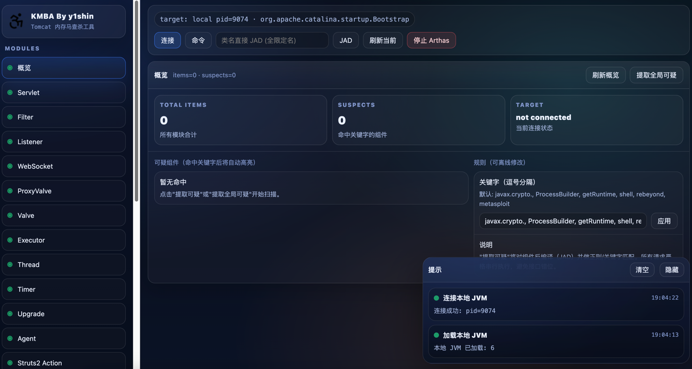

# KMBA — Tomcat / SpringMVC 内存马查杀工具

KMBA 是一个 Java 内存马应急响应工具，支持 **Web 管理界面**和 **CLI 命令行**两种模式，用于检测、分析和清除 Apache Tomcat 及 SpringMVC 应用中的内存 webshell（内存马）。它使用 [Arthas](https://arthas.aliyun.com/) 作为诊断引擎，通过 OGNL 表达式和 `vmtool` 命令直接检查运行中的 JVM 内部状态，无需重启目标应用。


## 功能特性

- **覆盖 16 种内存马类型** — Servlet、Filter、Listener、WebSocket、Valve、ProxyValve、Executor、Thread、Timer、Upgrade、SpringMVC Controller、SpringMVC Interceptor、SpringFlux WebFilter、SpringFlux NettyHandler、SpringFlux HandlerMethod、SpringFlux HandlerFunction
- **Web 管理界面** — 暗色主题 SPA，无 CDN 依赖，所有前端资源本地化
- **CLI 命令行模式** — 支持 headless 环境、脚本批量和 SSH 远程场景，无需浏览器
- **按需 JAD 反编译** — 直接从 JVM 中提取任意已加载类的 Java 源码并格式化展示
- **关键字可疑扫描** — 可自定义规则引擎，标记包含恶意特征的类（如 `ProcessBuilder`、`getRuntime`、`javax.crypto.*` 等）
- **多种卸载策略** — 针对不同类型提供温和（cancel/interrupt）和强制两种模式，附带风险说明
- **本地 & 远程连接** — 通过 `jps` + 内置 `arthas-boot.jar` 连接本地 JVM，或通过 WebSocket 连接远程 Arthas 代理

## 支持的内存马类型

| 模块                  | 目标类 / 范围                                                  |
|-----------------------|--------------------------------------------------------------|
| Servlet               | `StandardContext.servletMappings`                            |
| Filter                | `StandardContext.filterMaps` + `filterConfigs`               |
| Listener              | `StandardContext.applicationEventListenersList`              |
| WebSocket             | `WsServerContainer.configExactMatchMap`                      |
| Valve                 | `StandardContext.pipeline.valves`                            |
| ProxyValve            | `StandardPipeline` 的 first/basic 字段 (Java Proxy)          |
| Executor              | `NioEndpoint.executor`（被替换的执行器实例）                    |
| Thread                | 所有 `java.lang.Thread` 实例（按 target 类过滤）               |
| Timer                 | 所有 `java.util.TimerTask` 实例                              |
| Upgrade               | `AbstractHttp11Protocol.httpUpgradeProtocols`                |
| SpringMVC Controller  | `RequestMappingHandlerMapping.mappingRegistry`               |
| SpringMVC Interceptor | `RequestMappingHandlerMapping.adaptedInterceptors`           |
| SpringFlux WebFilter  | `FilteringWebHandler.chain.allFilters`                      |
| SpringFlux NettyHandler | `HttpServerConfig.doOnChannelInit`                        |
| SpringFlux HandlerMethod | `RequestMappingHandlerMapping.handlerMethods`            | 
| SpringFlux HandlerFunction | `RouterFunctionMapping.routerFunction`                |

## 架构

```
                    ┌─── Web 模式 ───┐
                    │  浏览器 (SPA)    │
                    │  REST API       │
                    └────────┬────────┘
                             │
┌──────────────┐      ┌──────┴───────┐      ┌─────────────────────┐
│  用户输入      │────▶│  KMBA        │─────▶│  Arthas Agent       │
│  (Web/CLI)    │      │  Spring Boot │ WS   │  (目标 JVM)          │
└──────────────┘      └──────┬───────┘      └─────────────────────┘
                             │                        │
                    ┌────────┴────────┐      ┌───────┴────────┐
                    │  CLI 模式        │      │  vmtool / ognl  │
                    │  java -jar cli  │      │  jad / sc       │
                    └─────────────────┘      └────────────────┘
```

所有命令执行严格遵循**串行化**，防止 WebSocket 消息交错导致结果混乱。

## 快速开始

### 环境要求

- JDK 8+
- Maven 3.6+
- 目标 JVM 需要能够被 Arthas attach

### 构建

```bash
mvn clean package -DskipTests
```

### Web 模式

```bash
java -jar target/KMBA.jar
```

启动后浏览器访问 `http://localhost:9099`，通过界面连接目标 JVM 并进行操作。

### CLI 模式

适用于 headless 服务器、SSH 远程操作或脚本批量处理：

```bash
java -jar target/KMBA-0.1.jar cli <pid> <command>
```

**列出组件：**

```bash
# 列出指定类型
java -jar KMBA.jar cli 54203 -l servlet
java -jar KMBA.jar cli 54203 -l filter
java -jar KMBA.jar cli 54203 -l smc        # SpringMVC Controller
java -jar KMBA.jar cli 54203 -l smi        # SpringMVC Interceptor

# 列出全部 12 种类型
java -jar KMBA.jar cli 54203 -l all
```

**卸载组件：**

```bash
java -jar KMBA.jar cli 54203 -u servlet /evil
java -jar KMBA.jar cli 54203 -u filter /evil
java -jar KMBA.jar cli 54203 -u proxyValve first com.InjectValve
java -jar KMBA.jar cli 54203 -u proxyValve basic com.InjectValve
java -jar KMBA.jar cli 54203 -u thread myThread com.EvilTask
java -jar KMBA.jar cli 54203 -u socket /ws com.MyWS
```

**反编译类：**

```bash
java -jar KMBA.jar cli 54203 -jad com.InjectServlet
```

**启用调试日志：**

```bash
java -jar KMBA.jar cli 54203 --log true -l all
```

### 启动脚本（release 包）

release 目录下提供了各平台的启动脚本，无参数启动 Web 模式，有参数自动进入 CLI 模式：

```bash
# Web 模式
./start.sh

# CLI 模式（参数透传给 java -jar KMBA.jar）
./start.sh cli 54203 -l all
./start.sh cli 54203 -u servlet /evil
./start.sh cli 54203 -jad com.InjectServlet
./start.sh --help
```

Windows 平台同理：

```cmd
start.bat cli 54203 -l all
start.bat cli 54203 -u servlet /evil
```

### Web 模式使用流程

1. 点击 **连接** 打开连接对话框
2. 选择一个本地 JVM 进程（通过 `jps` 自动发现），或输入远程 Arthas WebSocket 地址
3. 在左侧导航栏切换模块，枚举已加载的组件
4. 对任意条目点击 **JAD** 反编译查看源码
5. 对可疑条目点击 **UNLOAD** 进行卸载（部分类型提供温和/强制两种策略选择）
6. 使用 **提取可疑** 批量按关键字规则扫描组件
7. 使用 **命令** 终端执行任意 Arthas 原始命令

## 依赖

- Spring Boot 2.6.13（Web、Thymeleaf）
- [Java-WebSocket](https://github.com/TooTallNate/Java-WebSocket) 1.5.3 — Arthas WebSocket 通信
- [FastJSON](https://github.com/alibaba/fastjson) 1.2.83 — Arthas 返回结果的 JSON 解析
- Log4j 2.23.1 — 日志记录

## 免责声明

本工具仅限**授权的安全运维和应急响应**场景使用。请仅在您拥有或被明确授权分析的系统中使用。作者不承担任何滥用导致的后果。

## 已通过的测试环境
Nacos 2.2.2
XXL-JOB 2.1.2
fastjson 1.2.24
Ruoyi 3.4.0

## 感谢

- [Arthas — 阿里巴巴 Java 诊断工具](https://arthas.aliyun.com/)
- [su18](https://su18.org/)
- [drun1baby](https://drun1baby.top/)
- [y4er](https://y4er.com/)
- [chenlvtang](https://chenlvtang.top/)
- [FreeBuf](https://www.freebuf.com/)
- [ReaJason](https://github.com/)
- [Linux.do](https://linux.do/)
**排名不分先后，感谢各位前辈**

## 协议

本项目仅用于教学与防御性安全研究。
